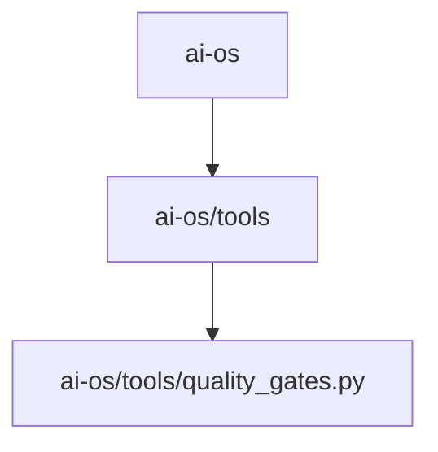

# 📚 AL-Sidr-Natural-Honey Documentation

Welcome to the complete documentation for this repository. This documentation is automatically generated and maintained by Woden Docbot.

  

## 🔗 Quick Links

[📂 ai-os](./ai-os/README.md)
[📋 Dependencies](./DEPENDENCIES.md)

---

> Official Al Sidr Natural Honey Shopify theme and e-commerce codebase with release evidence quality gates and local test tooling.

## 📖 Overview

This repository contains the official Al Sidr Natural Honey Shopify theme and e-commerce codebase for the Abu Dhabi–based raw Yemeni honey brand (Est. 1986). The top-level project includes storefront/theme assets and supporting web tooling implemented with common web and build technologies.

A dedicated ai-os directory holds deterministic release and delivery evidence gate logic and unit tests. The ai-os/tools area implements local quality gate checks (notably tools/quality_gates.py) used to verify release/delivery criteria locally before those results are consumed by upstream gate automation. The codebase shows a web stack and developer tooling using CSS, HTML, JavaScript/TypeScript, Node.js/npm, Python and Docker artifacts.

### 🧩 Key Components

| Component | Purpose | Technologies |
| --- | --- | --- |
| **ai-os** | Houses the AI OS release and delivery evidence gate logic and related deterministic quality gate tests used during the AI OS gate workflow. | `Python` |
| **ai-os/tools** | Collection of local, deterministic quality gate implementations and their unit tests for reviewing release and delivery evidence prior to automated gate consumption. | `Python` |
| **ai-os/tools/quality_gates.py** | Implementation of local review gates that determine pass/fail criteria for release and delivery evidence; accompanied by unit tests. | `Python` |

**Component Architecture:**

### 🏗️ Architecture

Root contains the Shopify theme/e-commerce code and developer tooling; ai-os is a focused subtree providing deterministic quality gate logic and tests (tools/ and quality_gates.py) used for local verification.

### 💡 Use Cases

- ✦ Provide the Shopify storefront/theme and e-commerce codebase for Al Sidr Natural Honey
- ✦ Run local deterministic release and delivery evidence quality gates and unit tests prior to upstream gate automation

### 🔧 Technologies

**Languages:**   

**Databases:** 
    

### 📦 External Dependencies

The following external packages are used across the project:

- `@modelcontextprotocol/sdk`
- `@types/node`
- `tsx`
- `typescript`
- `zod`

---

## 📑 Documentation Sections

### [ai-os](./ai-os/README.md)
Holds the AI OS release and delivery evidence gate logic and related deterministic quality gate tests used to validate release artifacts during the AI OS gate workflow.

This directory contains the deterministic quality gate implementation and its unit tests that are used during AI OS release and delivery evidence review.

---

## 📊 Documentation Statistics

- **Files Documented**: 2
- **Directories**: 3
- **Coverage**: 15%
- **Eligible Source Files**: 13
- **Last Updated**: 2026-10-24

---

## 🧭 How to Navigate

> ℹ️ **INFO**
> Each directory has its own README.md with detailed information about that section. Use the breadcrumb navigation at the top of each page to navigate back to parent directories.

### Navigation Features

- **Breadcrumbs** - At the top of each page, showing your current location
- **Directory READMEs** - Each folder has a comprehensive overview
- **File Documentation** - Click through to individual file documentation
- **Search** - Use GitHub's search or your IDE's search functionality

---

## 🤖 About Woden DocBot

This documentation is automatically generated and kept up-to-date by Woden DocBot, an AI-powered documentation assistant. DocBot analyzes code on every pull request and updates documentation to reflect changes.

### Features

- **Automatic Updates** - Documentation updates on every PR
- **Comprehensive Coverage** - Files, functions, classes, and directories
- **Smart Navigation** - Breadcrumbs, related files, and parent links
- **AI-Powered** - Uses Azure GPT models for intelligent documentation generation

---

*Generated by Woden DocBot for AL-Sidr-Natural-Honey*