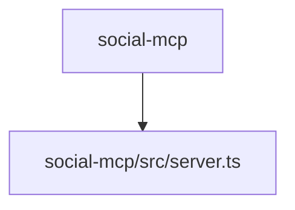

# 📚 AL-Sidr-Natural-Honey Documentation

Welcome to the complete documentation for this repository. This documentation is automatically generated and maintained by Woden Docbot.

  

## 🔗 Quick Links

[📂 social-mcp](./social-mcp/README.md)
[📋 Dependencies](./DEPENDENCIES.md)

---

> Official Al Sidr Natural Honey theme and e-commerce codebase with front-end assets and a TypeScript-based server integration for MCP components.

## 📖 Overview

This repository contains the codebase for Al Sidr Natural Honey's official theme and e-commerce site, alongside server-side wiring for Model Context Protocol (MCP) components. The project includes storefront assets and a dedicated integration for social-MCP services.

The social-mcp directory holds the server-side implementation surface: source files live under social-mcp/src and a single TypeScript module (server.ts) composes the MCP server stack and exports utilities for other server code. The codebase also includes front-end files (HTML, CSS, JavaScript) and is developed with Node.js/TypeScript tooling; project files indicate use of npm, Docker, Python, and SQL in the repository.

### 🧩 Key Components

| Component | Purpose | Technologies |
| --- | --- | --- |
| **social-mcp** | Houses the server-side implementation and wiring for the project's Model Context Protocol (MCP) components. | `TypeScript`, `Node.js` |
| **social-mcp/src/server.ts** | Single TypeScript module that composes the MCP server stack and exposes utilities consumed by the server application. | `TypeScript`, `Node.js` |

**Component Architecture:**

### 🏗️ Architecture

Front-end theme and assets (HTML/CSS/JavaScript) alongside a server-side integration under social-mcp/src/server.ts implemented in TypeScript and wired for MCP consumption.

### 💡 Use Cases

- ✦ E-commerce theme and storefront codebase for Al Sidr Natural Honey
- ✦ Server-side MCP integration and utilities for social features (social-mcp)

### 🔧 Technologies

**Languages:**   

**Databases:** 
    

### 📦 External Dependencies

The following external packages are used across the project:

- `@modelcontextprotocol/sdk`
- `@types/node`
- `tsx`
- `typescript`
- `zod`

---

## 📑 Documentation Sections

### [social-mcp](./social-mcp/README.md)
Houses server-side wiring and utilities for the Model Context Protocol (MCP) components used by the social-mcp project.

This directory contains the server-side implementation surface for the social-mcp project's Model Context Protocol (MCP) components.

---

## 📊 Documentation Statistics

- **Files Documented**: 1
- **Directories**: 3
- **Coverage**: 9%
- **Eligible Source Files**: 11
- **Last Updated**: 2026-10-20

---

## 🧭 How to Navigate

> ℹ️ **INFO**
> Each directory has its own README.md with detailed information about that section. Use the breadcrumb navigation at the top of each page to navigate back to parent directories.

### Navigation Features

- **Breadcrumbs** - At the top of each page, showing your current location
- **Directory READMEs** - Each folder has a comprehensive overview
- **File Documentation** - Click through to individual file documentation
- **Search** - Use GitHub's search or your IDE's search functionality

---

## 🤖 About Woden DocBot

This documentation is automatically generated and kept up-to-date by Woden DocBot, an AI-powered documentation assistant. DocBot analyzes code on every pull request and updates documentation to reflect changes.

### Features

- **Automatic Updates** - Documentation updates on every PR
- **Comprehensive Coverage** - Files, functions, classes, and directories
- **Smart Navigation** - Breadcrumbs, related files, and parent links
- **AI-Powered** - Uses Azure GPT models for intelligent documentation generation

---

*Generated by Woden DocBot for AL-Sidr-Natural-Honey*